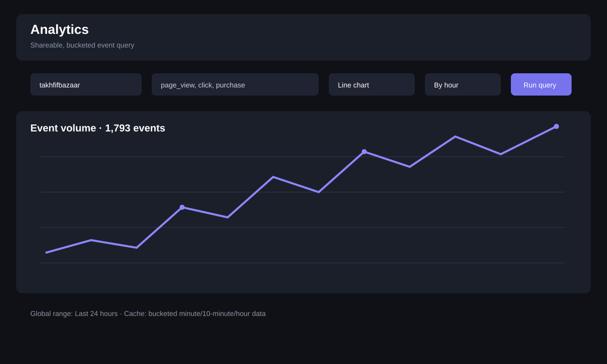

# Eye

**Understand your events. Explore your product.**

Eye is a multi-tenant analytics platform for collecting events, exploring dimensions, monitoring sessions and building reports.

[Documentation](https://arashrasoulzadeh.github.io/eye/) · [Quick start](docs/getting-started/README.md) · [API](docs/api/README.md)

[](https://github.com/arashrasoulzadeh/eye/actions/workflows/ci.yml)

## Explore Eye

- Guided analytics reports and advanced chart exploration.
- Event and dimension analysis across tenant and time scopes.
- Live session and event monitoring.
- REST and gRPC ingestion, with web and Go SDKs.
- Tenant management, schemas, cohorts and alerts.



## Run locally

Requires Go 1.26 and Node.js (use the version supported by the admin dependencies).

```bash
git clone https://github.com/arashrasoulzadeh/eye.git
cd eye
cd admin && npm ci && cd ..
make server
```

In another terminal, run `make admin` and open http://localhost:3000.
See the [setup guide](docs/getting-started/README.md) for configuration and credentials.

## Documentation

| Learn | Build | Operate |
| --- | --- | --- |
| [Admin guide](docs/admin/README.md) | [API reference](docs/api/README.md) | [Architecture](docs/architecture/README.md) |
| [Getting started](docs/getting-started/README.md) | [Web SDK](docs/sdk/web-sdk.md) | [Testing](docs/testing/README.md) |
| | [Go SDK](docs/sdk/go-sdk.md) | [Components](docs/components/README.md) |

## Documentation development

```bash
python -m pip install -r docs/requirements.txt
mkdocs serve
mkdocs build --strict
```

## License

MIT
