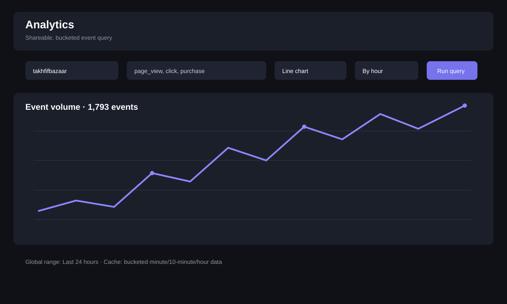

# راهنمای پنل مدیریت

پس از ورود، مستأجر و بازه زمانی سراسری را انتخاب کنید. این محدوده در صفحات مرتبط برای تحلیل رویدادها استفاده می‌شود.

## تحلیل

از گزارش‌های آماده Overview، Website، Engagement، Acquisition، Commerce و Search شروع کنید. الگوها رویدادهای موجود را انتخاب می‌کنند و داده جدید تولید نمی‌کنند. برای نمودارهای سفارشی از تحلیل پیشرفته استفاده کنید.

## ابعاد

ویژگی‌هایی مانند کشور، دستگاه یا کمپین را در رویدادهای منتخب مقایسه کنید. مقادیر ناموجود را از مقادیر واقعی جدا کنید و در صورت نیاز داده خام را بررسی کنید.

## کاربران و نشست‌ها

پروفایل کاربران، نشست‌ها و رویدادهای اخیر را بررسی کنید. در نبود شناسه صریح کاربر، گروه‌بندی بر اساس IP و عامل کاربر ممکن است انجام شود. مکان ناموجود نباید حدس زده شود.

## جریان زنده

برای مشاهده فعالیت جاری از جریان زنده استفاده کنید. نمودارهای تاریخی با داده‌های تجمیع‌شده تفاوت دارند.

## رفع اشکال

مستأجر، بازه زمانی، فیلتر رویداد و وضعیت درخواست API را بررسی کنید. کلید مدیر را در SDK قرار ندهید.
