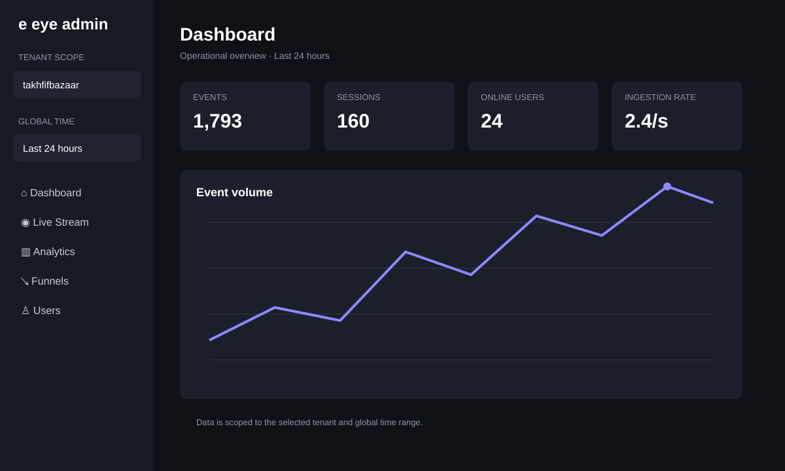
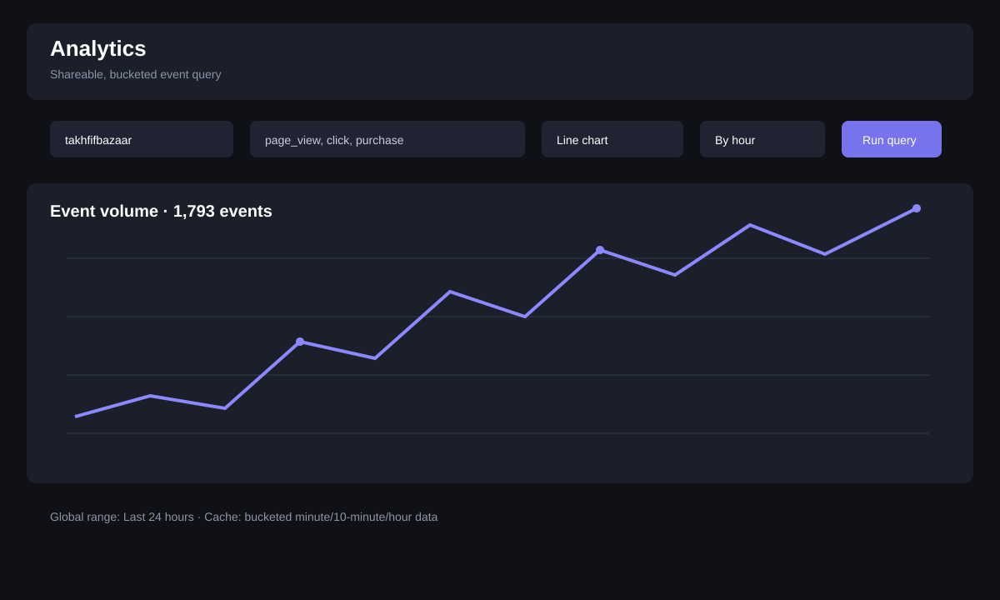
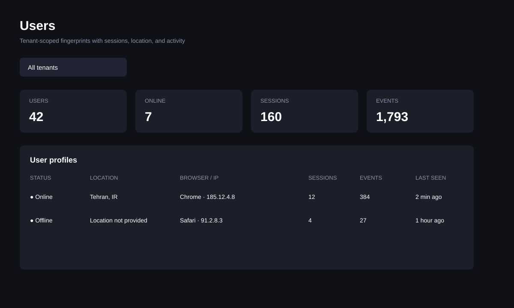

# Admin guide

The admin panel is a tenant-scoped workspace for querying events, monitoring live traffic, exploring funnels, and inspecting user/session activity.

## First login

1. Start the API and admin panel, or open your deployed admin URL.
2. Sign in with the server `ADMIN_KEY`/`admin_key` value.
3. Select a tenant in the sidebar. The selection is shared across pages.
4. Set **Global time** once. Event-based pages use the same range without a page reload.



## Analytics

Analytics accepts shareable URL parameters such as `tenant`, `events`, `time_hours`, `chart`, `aggregation`, and `group`.

```text
/analytics?tenant=<tenant-id>&events=page_view,click&time_hours=24&chart=line&aggregation=count&group=hour
```

Supported event bucket resolutions are `minute`, `10minute`, and `hour`. Persistent bucket rows are generated during ingestion and existing events are backfilled during server startup.



## Users and user profiles

Users are grouped by IP address and user agent when the event contract does not provide an explicit user ID. Select **View** on a profile to inspect its sessions, recent events, browser identity, and supplied location fields.

Location is read from `DeviceInfo` using `city`, `region`, and `country`, including nested `location` or `geo` objects. If the SDK did not send location data, the UI says **Location not provided** instead of guessing.



## Live stream

Use Live Stream for current activity. Start with no event filter, then narrow by tenant or event. Live counters and SSE event streams are push-based; historical charts use the persistent bucket API.

## API keys and tenant safety

- `ADMIN_KEY` is for the admin panel and administrative API routes.
- A tenant API key is for SDK ingestion and must match its tenant.
- Never commit either key to the repository or documentation examples.
- Derived/aggregated events are excluded from user-facing analytics and funnel counts.

## Troubleshooting empty charts

1. Confirm the selected tenant matches the URL `tenant` parameter.
2. Check the global time range; a short range can legitimately have no events.
3. Wait for the loading state to finish before interpreting `No data yet`.
4. Use **Refresh now** to retry the API request.
5. Verify the admin image is deployed at the release shown in the sidebar.
