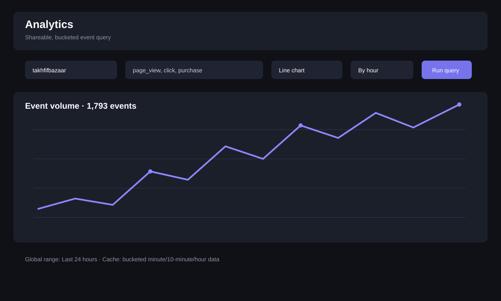

# Eye — تحلیل رویدادها

با Eye رفتار کاربران، رویدادهای محصول و فعالیت نشست‌ها را بررسی کنید. این سامانه از چند مستأجر مستقل، گزارش‌های آماده، تحلیل ابعاد و دریافت زنده رویداد پشتیبانی می‌کند.

[شروع کار](getting-started/README.fa.md){ .md-button .md-button--primary }
[راهنمای محصول](discovery.fa.md){ .md-button }

## مسیرهای یادگیری

- [مدیریت و تحلیل](admin/README.fa.md)
- [رابط برنامه‌نویسی](api/README.fa.md)
- [SDK وب](sdk/web-sdk.fa.md)
- [SDK گو](sdk/go-sdk.fa.md)
- [معماری](architecture/README.fa.md)
- [آزمون‌ها](testing/README.fa.md)
