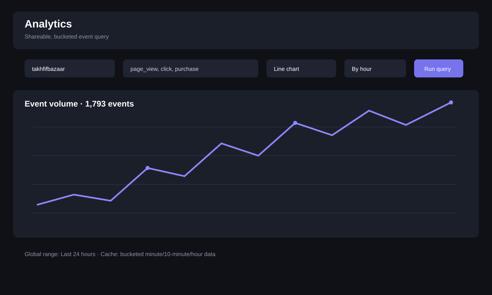

EVENT ANALYTICS · BUILT FOR EXPLORATION

# See what matters.

Turn events into answers with guided reports, dimensional exploration and live activity.

[Get started](getting-started/README.md){ .md-button .md-button--primary }
[Explore analytics](admin/README.md){ .md-button }

## From signals to insights

- :material-chart-line: **Analytics**

    Guided reports and advanced exploration for your product events.

    [Explore reports](admin/README.md#analytics)

- :material-lightning-bolt: **Live activity**

    Follow sessions and incoming events.

    [Monitor activity](admin/README.md#live-stream)

- :material-code-braces: **Developer friendly**

    Collect events with REST, gRPC, TypeScript or Go.

    [API reference](api/README.md)

- :material-shield-account: **Tenant-aware**

    Manage tenant scopes, keys and administrative access.

    [Admin guide](admin/README.md)

## Choose your path

- **Product teams**

    Start with a tenant, time range and report template.

    [Using Eye](admin/README.md)

- **Developers**

    Integrate your application and send your first events.

    [Web SDK](sdk/web-sdk.md) · [Go SDK](sdk/go-sdk.md)

- **Operators**

    Understand the services, storage and testing strategy.

    [Architecture](architecture/README.md) · [Testing](testing/README.md)

